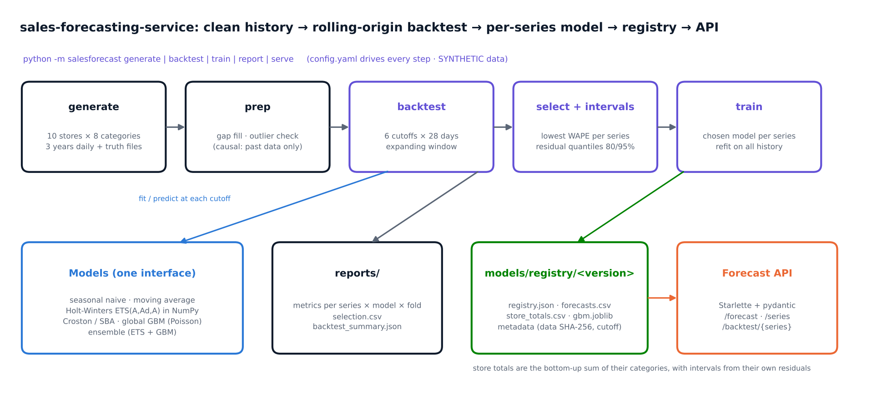
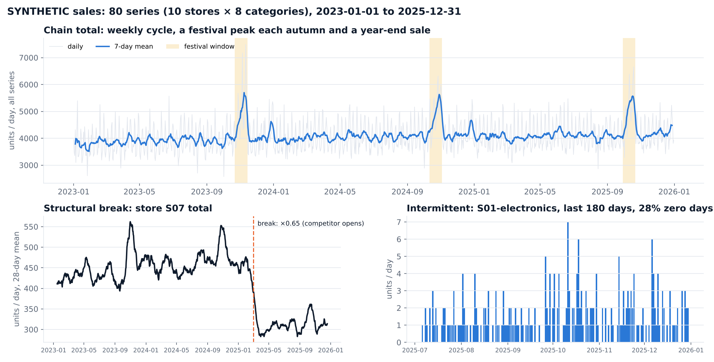
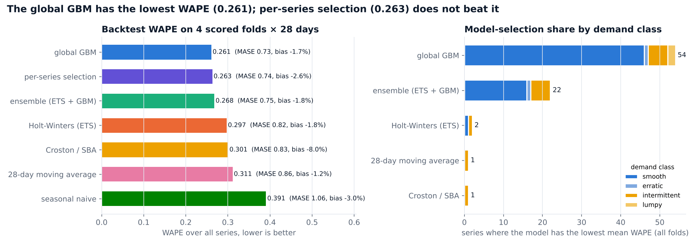
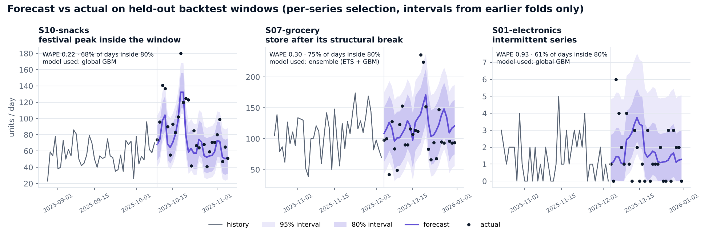
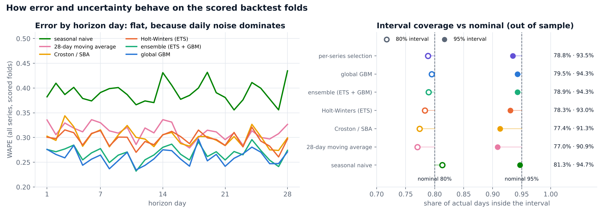

# Sales Forecasting Service

[](https://github.com/vishavjit-singh/sales-forecasting-service/actions/workflows/ci.yml)


Daily unit-sales forecasts for 10 stores × 8 product categories, built the way a forecast should be checked before anyone plans stock with it:

- **causal data prep**: gap filling and an outlier check that only look at the past
- **six models behind one interface**: seasonal naive, moving average, Holt-Winters (ETS) written in NumPy, Croston/SBA for intermittent demand, a global gradient-boosting model, and an ETS + GBM ensemble
- a **rolling-origin backtest** (expanding window, 6 cutoffs, 28-day horizon) with an explicit no-leakage test
- **per-series model selection** that is itself scored out of sample
- **prediction intervals** from backtest residuals, with measured coverage at 80% and 95%
- a **hierarchical check**: store totals forecast bottom-up from their categories, compared with forecasting the totals directly
- a **versioned model registry** and a **forecast API**

The data is **SYNTHETIC**. The generator writes every true component (trend, weekly and yearly cycles, festival uplift, promotions, price elasticity, a structural break, missing days and outliers) to `data/truth/`, so each finding below can be checked against the truth.



## Why this project

| Problem with forecasts in practice | How this repo handles it |
|---|---|
| A model looks good on one hand-picked test month | Rolling-origin backtest: every model is refitted at 6 cutoffs and scored on the next 28 days. Headline numbers come from the 4 folds after the 2 used for calibration |
| Cleaning or features quietly use the future | Prep is causal (same-weekday median of previous weeks, trailing median/IQR window). A test corrupts every sale after a cutoff, rebuilds the panel and refits all six models: their forecasts must not change |
| "Pick the best model per series" overfits the backtest | Selection for fold k uses only folds before k, so it is scored like any other model. Here it did **not** beat the best single model, and the README says so |
| Point forecasts with no sense of risk | 80% and 95% intervals from earlier folds' residuals (split-conformal ranks), with coverage measured on later folds, overall and by demand class |
| Category forecasts and store totals disagree | Store totals are the bottom-up sum of their categories, with their own calibrated intervals. Bottom-up is compared with forecasting the totals directly |
| Intermittent items break MAPE-style metrics | WAPE, sMAPE (0/0 counts as 0), MASE against a seasonal naive and bias. Series are classed with Syntetos-Boylan (ADI / CV²) and Croston/SBA is a candidate |
| "Which data and settings produced this forecast?" | Each registry version stores the SHA-256 of the sales file, the config hash, the training window, the backtest headline and library versions. `train` refuses to run if the data changed after the backtest |
| A library missing from one environment | Holt-Winters is implemented in NumPy. A CI job checks it against `statsmodels` |

## Results from the demo run

`make demo` generates the data, runs the backtest, publishes a registry version and renders these images. It took about 55 seconds on a shared 2-CPU machine.

The dataset has 80 series × 1,096 days (2023-01-01 to 2025-12-31). 822 rows are missing on purpose and 130 outliers are injected. 13 series are intermittent by construction (at least 30% zero days).



**Data prep.** All 822 missing days were filled. The outlier check replaced 112 values: 87 of the 130 injected outliers, plus 25 false flags (0.03% of all cells). 20 injected outliers fell on promotion or calendar-event days, which the check skips on purpose because spikes there are usually real demand. Of the other 23 it missed, 10 are on the low-count electronics and home-decor series, where a 4-8× spike on 1-2 units looks like normal noise. The remaining 13 stayed below the threshold.

**Backtest, 4 scored folds × 28 days × 80 series** (cutoffs 2025-09-11, 2025-10-09, 2025-11-06, 2025-12-04; folds from 2025-07-17 and 2025-08-14 are used only to calibrate intervals and selection):

| Model | WAPE | Bias | Mean MASE | 80% interval coverage | 95% interval coverage |
|---|---|---|---|---|---|
| Global GBM (Poisson, recursive) | **0.261** | −1.7% | 0.73 | 79.5% | 94.3% |
| Per-series selection | 0.263 | −2.6% | 0.74 | 78.8% | 93.5% |
| Ensemble (ETS + GBM) | 0.268 | −1.8% | 0.75 | 78.9% | 94.3% |
| Holt-Winters ETS(A,Ad,A) | 0.297 | −1.8% | 0.82 | 78.3% | 93.0% |
| Croston / SBA | 0.301 | −8.0% | 0.83 | 77.4% | 91.3% |
| 28-day moving average | 0.311 | −1.2% | 0.86 | 77.0% | 90.9% |
| Seasonal naive (last week) | 0.391 | −3.0% | 1.06 | 81.3% | 94.7% |



What the backtest shows:

- **The global GBM wins, and selection does not add to it.** Scored out of sample, per-series selection reached a WAPE of 0.263 against the GBM's 0.261. The top three models are within 0.007 WAPE of each other, so choosing per series from 2-5 earlier folds of noisy daily data mostly picks up noise. A single global model is the simpler choice here. (The final choice over all folds, used by the registry, is the GBM for 54 series and the ensemble for 22.)
- **Festival weeks are where the GBM earns its place.** It sees the festival calendar as a feature. Inside the festival windows its WAPE is 0.250, against 0.305 for Holt-Winters, which only has weekly seasonality. Outside them the gap is smaller: 0.264 vs 0.295.
- **Croston/SBA rarely wins, even on intermittent series.** Of the 13 intermittent series it was chosen for 1. The GBM and the ensemble took 10 of them, because Poisson loss with store, category and calendar features handles low counts well. Croston's flat forecast also under-predicts in the scored folds (bias −8.0%): it cannot follow the festival and year-end rises that fall inside them.
- **The structural break** (store S07 drops to 65% from 2025-03-01) happened 4.5 months before the first cutoff. By then every model had adapted: S07's WAPE is 0.278-0.298 for all models except seasonal naive (0.383).
- **Error by horizon is flat.** Daily Poisson-gamma noise is the main error source at every horizon, so WAPE at day 28 is close to day 1. The recursive GBM does not visibly drift.
- **Intervals slightly under-cover.** The 80% intervals of the selected models contain 78.8% of actual days and the 95% intervals 93.5%. They are close on smooth series (79.6% / 94.6%) and weaker on the 13 intermittent ones (76.7% / 89.1%), where 56-140 residuals per series are few for a 95% quantile.





**Hierarchy (store totals, 10 stores, scored folds):**

| Store-total forecast | WAPE | Bias |
|---|---|---|
| Bottom-up: sum of the selected category forecasts | 0.130 | −2.5% |
| Bottom-up: sum of the GBM category forecasts | 0.129 | −1.7% |
| Holt-Winters fitted directly on the store totals | 0.150 | −1.8% |
| Seasonal naive on the store totals | 0.192 | −2.9% |

Bottom-up beats forecasting the totals directly, most likely because the category models see promotions, prices and the festival calendar while the direct Holt-Winters model does not. Store-total intervals, calibrated on the bottom-up residuals of earlier folds, cover 77.2% (80% nominal) and 94.4% (95% nominal).

> All data is **synthetic** ([`generate.py`](src/salesforecast/generate.py), seeded) and is not a benchmark for real retail data. Every number above is in `reports/backtest_summary.json` and `data/prepared/prep_report.json` after `make demo`.

## Quickstart

```bash
git clone https://github.com/vishavjit-singh/sales-forecasting-service.git
cd sales-forecasting-service
python -m venv .venv && source .venv/bin/activate
make install
make demo        # generate → backtest → train → charts → two example forecasts
make test        # 39 tests run locally; 6 more need statsmodels or httpx (both installed in CI)
make serve       # API on http://127.0.0.1:8000
```

`docker compose up --build` builds an image that generates the data, runs the backtest and trains at build time, then serves the API on port 8000.

## Usage

### CLI

```text
python -m salesforecast generate      # SYNTHETIC sales, price/promotion plan, truth files
python -m salesforecast backtest      # clean, backtest all models, select per series → reports/
python -m salesforecast train         # refit chosen models on all history → models/registry/<version>/
python -m salesforecast forecast --store S03 --category snacks --horizon 7
python -m salesforecast report        # README charts → docs/images/
python -m salesforecast serve         # uvicorn on :8000
```

```text
$ python -m salesforecast forecast --store S03 --category snacks --horizon 3
S03-snacks · model: gbm · registry 2025-12-31_99d27375 · SYNTHETIC
date          forecast        80% interval        95% interval
2026-01-01        86.4      48.0–138.5          30.8–186.7
2026-01-02        88.4      50.0–140.5          32.8–188.7
2026-01-03       118.9      80.5–171.0          63.3–219.2
```

Leave out `--category` to get the store total (the bottom-up sum of its 8 categories, with its own intervals).

### API

| Endpoint | Returns |
|---|---|
| `GET /health` | status, registry version, number of series |
| `GET /metadata` | data SHA-256, training window, forecast window, backtest headline, library versions |
| `GET /series?store=S01` | each series with its chosen model, demand class and backtest WAPE |
| `GET /forecast?store=S01&category=snacks&horizon=14` | point forecast with 80% and 95% intervals (horizon 1-28) |
| `GET /forecast?store=S01&horizon=7` | store total, bottom-up |
| `POST /forecast` | batch: `{"requests": [{"store", "category"?, "horizon"?}, ...]}`, up to 200 |
| `GET /backtest/S01-snacks` | per-model, per-fold WAPE, MASE, bias and MAE for one series |

```text
$ curl -s "localhost:8000/forecast?store=S01&category=snacks&horizon=2"
{"version":"2025-12-31_99d27375","series":"S01-snacks","store":"S01","category":"snacks","level":"series",
 "model":"gbm","unit":"units/day","forecast":[
  {"date":"2026-01-01","h":1,"forecast":73.43,"lo_80":47.86,"hi_80":113.51,"lo_95":33.02,"hi_95":148.94},
  {"date":"2026-01-02","h":2,"forecast":79.43,"lo_80":53.86,"hi_80":119.51,"lo_95":39.01,"hi_95":154.93}]}

$ curl -s "localhost:8000/forecast?store=S01&horizon=1"
{"version":"2025-12-31_99d27375","store":"S01","category":null,"level":"store_total","method":"bottom_up",
 "unit":"units/day","forecast":[
  {"date":"2026-01-01","h":1,"forecast":466.99,"lo_80":392.34,"hi_80":568.68,"lo_95":315.59,"hi_95":691.83}]}

$ curl -s "localhost:8000/forecast?store=S01&horizon=40"
{"error":{"code":"validation_error","message":"request validation failed",
 "errors":[{"loc":"horizon","msg":"Input should be less than or equal to 28"}]}}
```

Unknown stores, categories or series return `404`, invalid parameters `422` with the field, and malformed JSON `400`. The API serves the version named in `models/registry/LATEST`. Forecasts are computed once at `train` time, so requests only slice them.

### Pipeline details

- **Data** ([`generate.py`](src/salesforecast/generate.py)): expected units = base × store size × store trend × weekday profile × yearly cycle × festival ramp × holiday × year-end sale × (price / list price)^elasticity × promotion display lift × structural break. Observed units are Poisson-gamma draws around that. The price and promotion plan (`plan.csv`) runs 56 days past the last sale and is treated as known in advance, like a promotion calendar.
- **Prep** ([`prep.py`](src/salesforecast/prep.py)): a missing day becomes the median of the same weekday over the previous 4 weeks. A value above the trailing 28-day median + 6 × sigma (sigma = IQR / 1.349, at least √median + 1) is replaced by the same-weekday median (capped at the threshold), except on promotion and calendar-event days.
- **Models** ([`models.py`](src/salesforecast/models.py), [`ets.py`](src/salesforecast/ets.py)): each model is fitted on a `TrainView` that holds sales only up to the cutoff, plus the calendar and the price/promotion plan. Holt-Winters runs the recursion for all series and many parameter sets at once in NumPy and picks (α, β, γ, φ) by a coarse grid plus two local grid rounds. The GBM is one `HistGradientBoostingRegressor` (Poisson loss) for all series, with lags 1-28, trailing means, the same-weekday mean, store, category, calendar, promotion and price index. It forecasts recursively day by day, and the same function builds features for training and for each step (a test checks this).
- **Backtest** ([`backtest.py`](src/salesforecast/backtest.py)): scores every model at every cutoff, then builds the out-of-sample selection, the intervals and the store-total comparison.
- **Registry** ([`registry.py`](src/salesforecast/registry.py)): `models/registry/<end date>_<data hash>/` with `metadata.json`, `registry.json` (model, parameters, backtest WAPE per model and interval offsets for each series), `forecasts.csv`, `store_totals.csv`, `backtest_metrics.csv` and `gbm.joblib`.

All settings are in [`config.yaml`](config.yaml).

## Project structure

```
├── config.yaml                    # data generator, calendar, prep, backtest, models, API limits
├── src/salesforecast/
│   ├── generate.py                # SYNTHETIC sales + price/promo plan + truth files
│   ├── events.py                  # festival / holiday / year-end calendar features
│   ├── prep.py                    # wide panel, causal gap filling and outlier replacement
│   ├── ets.py                     # vectorised Holt-Winters ETS(A,Ad,A) + grid search
│   ├── models.py                  # Forecaster interface and the six models
│   ├── metrics.py · intervals.py  # MAE, RMSE, WAPE, sMAPE, MASE, bias · conformal residual intervals
│   ├── backtest.py                # rolling origin, selection, coverage, hierarchy, summary
│   ├── registry.py                # train + versioned registry, read side for the API
│   ├── api.py                     # Starlette + pydantic forecast service
│   ├── report.py · cli.py         # README charts · `python -m salesforecast …`
├── tests/                         # 45 tests (39 run locally) + a tiny in-repo ASGI client
├── docs/images/                   # charts rendered by `make demo`
├── Dockerfile · docker-compose.yml · Makefile
└── .github/workflows/ci.yml       # tests + demo (3.11, 3.12) · statsmodels parity · Docker smoke test
```

## Testing

```bash
make lint && make test
```

The suite runs one small end-to-end pipeline (3 stores, 2 years, 4 cutoffs) in a temporary directory and tests against it.

- **Data:** the generator is deterministic; the truth files account for every missing row and outlier; the break and price rise land on the right dates; intermittent series come from the low-volume categories
- **Prep:** gap filling on a hand-worked series; exempt promotion spikes are kept; cleaning is causal; the outlier check finds at least 60% of the injected outliers on non-event days with rare false flags; festival and holiday features
- **Metrics and intervals:** known values, zero handling for sMAPE and WAPE, conformal ranks, clipping at zero
- **Models:** the vectorised Holt-Winters matches a scalar textbook implementation; the fit recovers a clean seasonal series; seasonal naive, moving average and a hand-worked Croston/SBA example; GBM training features equal the recursive-step features; all models return finite, non-negative forecasts; the ensemble reuses fitted members
- **Backtest:** cutoff layout; **no leakage** (future sales corrupted ×50, all six models give identical forecasts); selection and intervals for fold k use only earlier folds; summary sanity and coverage bounds; bottom-up beats naive totals
- **Registry and API:** version, data hash and windows in the metadata; `train` refuses changed data; every endpoint with ordered intervals; the store total equals the sum of its categories; validation, 404, malformed JSON and batch limits; the CLI
- **CI only:** `statsmodels` parity (identical fitted values and forecasts with fixed parameters; similar SSE and forecasts after optimisation) and the Starlette `TestClient` path, which needs `httpx`

## Limitations and roadmap

- The data is synthetic, so real sales will be messier: stock-outs that hide demand, new and discontinued items, and calendars that differ by region. The numbers here are not a benchmark.
- `statsmodels`, `fastapi`, `httpx`, `ruff` and Docker were not available where this was built. Locally, the Holt-Winters code was checked against a scalar reference implementation, the API was tested through an in-repo ASGI client and a real `uvicorn` server, and linting used a stand-in for ruff's E/F/W rules. The statsmodels parity tests, the `TestClient` test, `ruff check .` and the Docker build first run in CI.
- The API uses Starlette, the ASGI toolkit FastAPI is built on, because FastAPI could not be installed either. Swapping it in only touches `api.py`.
- Intervals are the same width at every horizon, and they under-cover a little on intermittent series. Next steps are horizon-dependent offsets, pooling residuals across similar series, and quantile loss for the GBM.
- Holt-Winters has weekly seasonality only. Initial states come from a heuristic rather than being optimised, which is one reason the parity test allows a tolerance after optimisation.
- Next: MinT reconciliation instead of pure bottom-up, an exogenous-aware ETS, scheduled retraining that only promotes a new registry version when it wins the backtest, and a drift check on recent forecast errors.

## Author

**Vishavjit Singh Saini**, Data Engineer
[Portfolio](https://vishavjit-singh.pages.dev/) · [LinkedIn](https://www.linkedin.com/in/vishavjit-singh-7011211ab/) · [GitHub](https://github.com/vishavjit-singh)

## License

[MIT](LICENSE)
